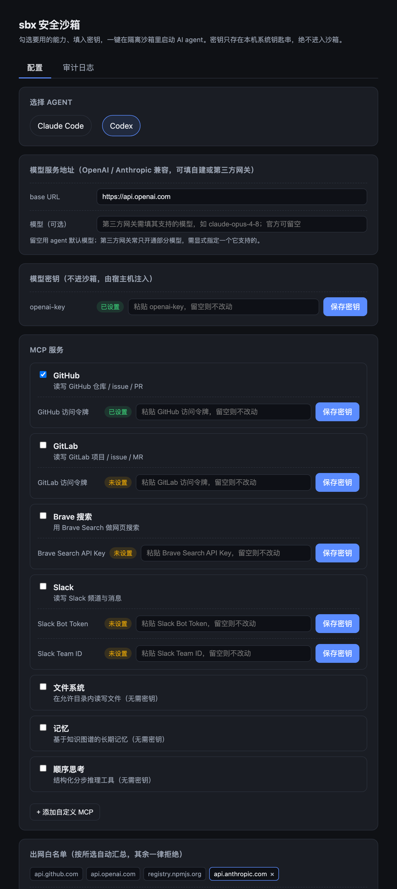
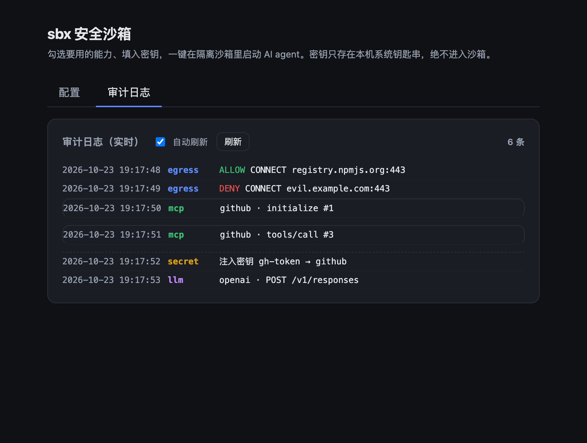

# sbx — 桌面级安全沙箱（Demo）

[](https://github.com/jhliao5907/hackathon2026/actions/workflows/ci.yml)
[](LICENSE)

在隔离的 Docker 容器里运行主流 AI agent（Claude Code / Codex / dsh），
**配置任何 MCP 时都无需在沙箱内填写任何密钥**。

<p align="center">
  
  <br><em>图形配置界面（<code>sbx ui</code>）：勾选 MCP、填密钥、一键启动，无需手写配置</em>
</p>

核心机制一句话：

> agent 在隔离容器里，MCP 配置只指向宿主机 **broker** 的本地 URL（零密钥）；
> **连 agent 自己的模型 key 也不进沙箱**（容器只放占位值，真实 key 由宿主机注入代理补上）；
> 真实凭据存在宿主机 **Keychain**，由 broker/injector 在容器外注入；
> MCP server 本身也**跑在受限容器里**；容器出网一律走 **白名单网关**（deny-by-default）；
> agent 容器**只读 rootfs + 资源上限**，改动落在**一次性工作区**、经你 **diff 审批**才回写；
> 所有 MCP 调用 / 出网 / 凭据注入都写入**审计日志**。

## 设计要点

- **信任边界清晰**：宿主机为可信侧，沙箱内 agent 为不可信工作负载；密钥、宿主机文件、公网出口都留在可信侧。
- **凭据与使用者分离**：agent 拿到「能力」而非「凭据」，凭据在调用时由可信侧注入。
- **默认拒绝**：出网、能力、文件可见性都从关闭开始，仅按需开最小集合。
- **可观测**：关键行为全程留痕。

详见 [DESIGN.md](DESIGN.md)。

## 架构

```
宿主机                                          隔离容器 (agent)
┌────────────────────────────┐   docker run  ┌──────────────────────────┐
│ sbx CLI                    │──────────────▶│ claude code / codex / dsh│
│ Keychain ──注入env──▶ broker│◀── HTTP ──────│ MCP: http://host:8771/github (无密钥)
│ sandbox.yaml (白名单/清单) │               │ 出网 → HTTP_PROXY=网关    │
│ 出网网关 :8772 (白名单)    │◀── 所有出网 ──│                          │
└────────────────────────────┘               └──────────────────────────┘
```

## 目录结构

```
cmd/sbx/              CLI 入口 (cobra)
internal/config/      解析 sandbox.yaml（无敏感值）
internal/secrets/     系统 Keychain 读写
internal/broker/      MCP 凭据代理：HTTP↔stdio 桥接 + 密钥注入，MCP server 容器化（核心）
internal/injector/    凭据注入反向代理：模型 key 不落沙箱
internal/gateway/     出网白名单正向代理（deny-by-default）
internal/audit/       结构化审计日志（JSONL）
internal/workspace/   一次性工作区：快照 / diff / 审批回写
internal/sandbox/     组装 docker run 启动隔离容器（只读 rootfs + 资源上限）
internal/catalog/     预设目录：常见 MCP server + agent 代理（供 GUI 勾选生成配置）
internal/webui/       本地图形配置界面（单页 Web + JSON API，go:embed）
docker/               agent 容器镜像 + 启动脚本
```

宿主机侧启动三个服务：broker `:8771`、出网网关 `:8772`、凭据注入代理 `:8773`，审计写入 `./sbx-audit.log`。

## 一键启停本地服务

```bash
./scripts/sbxctl.sh start     # 确保 Docker、构建、起配置界面并打开浏览器
./scripts/sbxctl.sh status    # 查看进程/端口/Docker 状态
./scripts/sbxctl.sh stop      # 停止本地服务（--stop-docker 可连 Colima 一起停）
./scripts/sbxctl.sh restart   # 重启  ·  logs 跟踪日志
```

默认只起配置界面；点「启动沙箱」时 `sbx run` 会自管后端服务（broker/gateway/injector），
避免端口冲突。需要独立常驻后端（联调/手动驱动）时加 `start --serve`。
PID 与日志写入 `.sbx-run/`（已 gitignore）。

## 图形界面（推荐给最终用户）

不想碰配置文件？一条命令打开图形界面，勾选 MCP、填密钥、一键启动：

```bash
./sbx ui        # 本机浏览器打开 http://127.0.0.1:8780（或用上面的 sbxctl start）
```

界面内可：选择 agent（Claude/Codex）、设置模型服务地址与模型（支持自建/第三方 OpenAI/Anthropic 兼容网关）、
勾选内置 MCP 服务（GitHub / GitLab / Brave 搜索 / Slack / 文件系统 / 记忆 / 顺序思考）、
**添加自定义 MCP**（名称 + 命令 + 可选密钥）、**自定义出网白名单域名**、
为需要的服务填密钥（存入系统钥匙串、不进沙箱）、保存配置并一键启动。
全程无需手写 `sandbox.yaml`，也无需知道 npx 命令、docker 镜像、代理 header 等技术细节。

「审计日志」标签页可**实时查看**沙箱的全部行为（出网放行/拦截、MCP 调用、模型调用、凭据注入）：

<p align="center"></p>

> 密钥只写入本机系统钥匙串；界面仅监听 `127.0.0.1`。启动按钮会拉起一个终端窗口运行 agent（TUI）。

## 命令行用法

前置：已安装 Docker、Go 1.21+。

```bash
# 0) 编译并构建 agent 镜像
go build -o sbx ./cmd/sbx
docker build -f docker/Dockerfile.agent -t sbx-agent:latest .

# 1) 生成配置（不含任何密钥）
./sbx init

# 2) 把密钥存入系统 Keychain（一次即可，输入不回显）
./sbx secret set gh-token
# 也支持非交互导入（值从 stdin 读，不进命令行参数）：
#   printf '%s' "$TOKEN" | ./sbx secret set gh-token

# 3) 在隔离沙箱里启动 Claude Code
./sbx run claude      # 或 ./sbx run codex / ./sbx run dsh
# 退出后会展示沙箱内的改动 diff，确认 y 才回写原目录
# --ephemeral=false 直接读写原目录；--yes 跳过审批

# 可选：只起宿主机侧服务（broker/gateway/injector），便于联调
./sbx serve
```

终端用户全程**只在第 2 步输入一次密钥**，且它只进宿主机 Keychain；
沙箱内的 MCP 配置只有一个 `http://host.docker.internal:8771/github` 地址。

## 验证「安全」的四个点

```bash
# ① 凭据不落沙箱：进入容器后查不到任何真实 key
./sbx run claude            # 不带 agent 参数时 entrypoint 会给个 shell
env | grep -i token         # 空
cat ~/.claude.json          # MCP 只有 broker URL，无密钥

# ② MCP 可用：容器内 agent 经 broker 调 github MCP，宿主机侧已注入密钥

# ③ 出网 deny-by-default
curl https://api.github.com      # 白名单内 → 通
curl https://evil.example.com    # 白名单外 → 被网关 403 拦截（宿主机日志可见 DENY）

# ④ 隔离：容器以非 root + --cap-drop ALL 运行，只挂载当前目录
ls ~/.ssh                   # 看不到宿主机密钥文件

# ⑤ 模型 key 也不落沙箱：容器里只有占位值
env | grep ANTHROPIC_API_KEY   # = sandbox-placeholder（非真实 key）

# ⑥ 审计：宿主机侧查看所有行为
tail -f sbx-audit.log       # JSONL：egress/mcp/llm/secret 事件
```

## 真机联调结果（已验证）

在 macOS + Colima(Docker) 上用一个**无需密钥**的 filesystem MCP server 跑通整条链路：

- ✅ 镜像：非 root(uid 10001)、只读 rootfs（写 `/` 失败、`/tmp` 与家目录 tmpfs 可写）、`CapEff=0`（能力全丢）
- ✅ broker：首个请求真实 `docker run` 起 MCP 容器，经网关下载 npx 包，`initialize`/`tools/list` 返回 **14 个真实工具**，通知消息返回 202
- ✅ 出网：网关日志 `ALLOW registry.npmjs.org`、`ALLOW api.github.com`、`DENY example.com`（deny-by-default）
- ✅ 凭据不落沙箱：容器内 `env` 无任何 key/token/secret；真实 Claude Code `claude mcp list` 显示
  `filesystem: http://host.docker.internal:8771/filesystem (HTTP) - ✔ Connected`，**配置里只有 broker URL**
- ✅ 隔离：容器内看不到宿主机 `/Users`、读不到 `.ssh`
- ✅ 审计：`sbx-audit.log` 记录全部 egress/mcp 事件（JSONL）

> 唯一需要你本人完成的是让 Claude **真实产出回答**：填入你的 Anthropic key（`sbx secret set anthropic-key`）
> 并在容器内首次登录。链路其余部分均已真机验证。

## Agent 支持

| Agent | MCP 零密钥接入 | 模型 key 不落沙箱 | 说明 |
|---|---|---|---|
| **Claude Code** | ✅ 已真机验证 | ✅ injector 注入 `x-api-key` | 容器内 `claude mcp add` 注册为 broker URL |
| **Codex** | ✅ 已真机验证（含会话内真实工具调用） | ✅ 已真机验证（含真实模型调用） | 容器内 `codex mcp add --url` 写入 `~/.codex/config.toml`；自定义 provider 把模型请求经注入代理转发，容器内仅占位 key |
| **dsh** | — | — | CLI 入口已预留，镜像与自动配置待接入具体目标后补齐 |

> Codex 自 0.119 起忽略 `OPENAI_BASE_URL`，故改用 `~/.codex/config.toml` 自定义 provider 把模型请求导向注入代理。
> 已验证：容器内 Codex 以 `OPENAI_API_KEY=占位值` 发起 `codex exec`，injector 在宿主机注入真实 key 后转发
> 上游（OpenAI 兼容网关），模型正常返回；真实 key 全程不在容器内。

## 测试

```bash
go test ./...
```

覆盖：出网白名单判定、实时代理放行/拦截、broker 密钥注入 + HTTP↔stdio 桥接、
通知消息 202、docker run 加固参数、配置解析与密钥名去重。

## Demo 范围边界

- 隔离后端用 Docker 容器（非 microVM）；出网只做域名白名单，未做短期 token 签发。
- 预装并打通 Claude Code + github MCP server；codex/dsh 走同一入口参数化。
- 仅 CLI，无 GUI。
